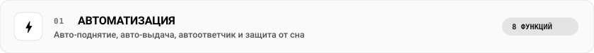
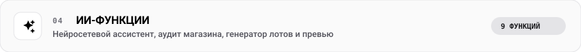
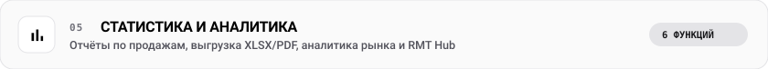
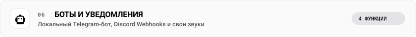
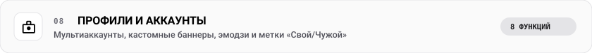
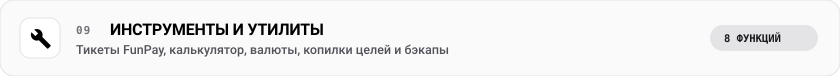
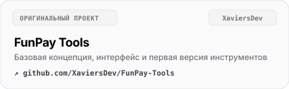
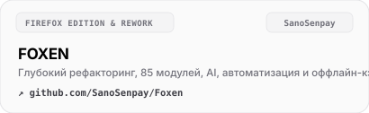
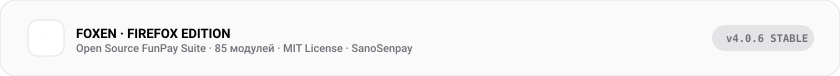

<picture>
  <source media="(prefers-color-scheme: dark)" srcset="assets/readme/hero-dark.svg">
  
</picture>

  

<a href="https://addons.mozilla.org/ru/firefox/addon/foxen/"><picture><source media="(prefers-color-scheme: dark)" srcset="assets/readme/btn-install-dark.svg"></picture></a>
&nbsp;&nbsp;
<a href="https://web.foxen.site/"><picture><source media="(prefers-color-scheme: dark)" srcset="assets/readme/btn-web-dark.svg"></picture></a>
&nbsp;&nbsp;
<a href="https://github.com/SanoSenpay/Foxen"><picture><source media="(prefers-color-scheme: dark)" srcset="assets/readme/btn-github-dark.svg"></picture></a>

  

<picture>
  <source media="(prefers-color-scheme: dark)" srcset="assets/readme/wave-dark.svg">
  
</picture>

  

<a href="#01-автоматизация"><picture><source media="(prefers-color-scheme: dark)" srcset="assets/readme/nav-01-dark.svg"></picture></a>
<a href="#02-лоты-и-цены"><picture><source media="(prefers-color-scheme: dark)" srcset="assets/readme/nav-02-dark.svg"></picture></a>
<a href="#03-чат-и-переписка"><picture><source media="(prefers-color-scheme: dark)" srcset="assets/readme/nav-03-dark.svg"></picture></a>

  

<a href="#04-ии-функции"><picture><source media="(prefers-color-scheme: dark)" srcset="assets/readme/nav-04-dark.svg"></picture></a>
<a href="#05-аналитика"><picture><source media="(prefers-color-scheme: dark)" srcset="assets/readme/nav-05-dark.svg"></picture></a>
<a href="#06-боты-и-уведомления"><picture><source media="(prefers-color-scheme: dark)" srcset="assets/readme/nav-06-dark.svg"></picture></a>

  

<a href="#07-кастомизация"><picture><source media="(prefers-color-scheme: dark)" srcset="assets/readme/nav-07-dark.svg"></picture></a>
<a href="#08-профили"><picture><source media="(prefers-color-scheme: dark)" srcset="assets/readme/nav-08-dark.svg"></picture></a>
<a href="#09-утилиты"><picture><source media="(prefers-color-scheme: dark)" srcset="assets/readme/nav-09-dark.svg"></picture></a>

  

<picture>
  <source media="(prefers-color-scheme: dark)" srcset="assets/readme/wave-dark.svg">
  
</picture>

 

<picture>
  <source media="(prefers-color-scheme: dark)" srcset="assets/readme/section-automation-dark.svg">
  
</picture>

| Модуль | Назначение и возможности |
|:---|:---|
| **Авто-Поднятие лотов** | Автоматическое поднятие ваших предложений по настраиваемому таймеру. Расширение само читает ответ серверов FunPay («подождите ещё 12 минут») и ставит таймер секунда в секунду без лишних запросов. Поднимает все лоты, выбранные категории или только лоты с автовыдачей. |
| **Поднятие всех лотов через одну кнопку** | В своём профиле вы можете увидеть кнопку, которая позволяет поднять все лоты одним нажатием. |
| **Авто-Выдача товаров** | Мгновенная автоматическая выдача ваших товаров. Лоты сгруппированы по категориям, виден остаток товаров. Лот сам деактивируется, когда товары заканчиваются, и сам активируется, когда пополните запас. |
| **Авто-Ответчик** | Автоматически отвечайте покупателям при получении таких событий как: получение отзыва, подтверждение заказа, поступление нового заказа. Поддерживает переменные {orderid}, {orderlink}, {lotname}, имитацию набора текста и настраиваемый кулдаун. |
| **Авто-ответ по ключевым словам** | При получении определённого слова расширение отправит заранее подготовленный текст. |
| **Бонус за отзыв 5 звезд** | Автоматически отправляйте в чат приятный бонус (текст, промокод или картинку) за пятизвёздочный отзыв. Можно задать задержку перед выдачей подарка. |
| **Фоновый движок и 5-уровневая защита от сна** | Мощный движок фоновых процессов и 5-уровневая защита от сна. Работает без перебоев даже при свёрнутом браузере, поддерживает свежие обновления и новые cookies FunPay. |
| **Защита от спама** | Бот не отвечает сам себе, не флудит в чат одинаковыми сообщениями, а автоответы полностью игнорируют ваши собственные покупки. |

  <a href="#foxen">↑ Наверх к разделам</a>

 

<picture>
  <source media="(prefers-color-scheme: dark)" srcset="assets/readme/section-lots-dark.svg">
  
</picture>

| Модуль | Назначение и возможности |
|:---|:---|
| **Быстрое редактирование цен** | Возможность менять цену прямо в таблице предложений без захода в страницу лота. Точный расчёт комиссии, предпросмотр, изменение цен в процентах и поле цены покупателю. |
| **Массовый редактор лотов** | Инструмент для быстрого изменения цен, описания и валюты для множества лотов одновременно. Есть функция «Найти и заменить» для точечной замены кусков текста, в том числе через RegEx. |
| **Разделение неактивных предложений** | На странице редактирования предложений появляется разделитель, который явно отличает активные и неактивные лоты. |
| **Удаление неактивных лотов** | На странице редактирования предложений вы можете увидеть кнопку, которая удаляет неактивные лоты автоматически. |
| **Быстрое включение лотов** | Выделите неактивные лоты на странице «Ваши предложения» — появится кнопка «Включить», которая в 1 клик включает все выделенные лоты. |
| **Копирование лота** | На страницах лотов появляется кнопка копирования, которая автоматически собирает нужные данные для копирования. Можно скопировать лот прямо со страницы купленного товара (копирует и автовыдачу). |
| **Выбор и копирование чужих лотов** | На странице чужого профиля есть кнопка «Выбрать» — отмечаете нужные чужие лоты и копируете их себе пачкой. |
| **Продвинутое клонирование лотов** | Массово создавайте копии лота в разных категориях (например, на разных серверах). |
| **Экспорт и Импорт лотов** | Сохранение предложений в один .json файл. Имеется функция конвертера лотов из FPC, а также возможность отложить импорт на 24 часа, если FunPay временно блокирует создание лотов. |
| **Реальные цены лотов и комиссия раздела** | Показывает над лотами их настоящую цену с учётом комиссии площадки и саму комиссию раздела. |
| **Заметки к лотам** | Кликните ПКМ по своему лоту и нажмите «Добавить заметку» (или добавьте через раздел «Лоты» в меню). Прямо возле кнопки редактирования можно добавить заметку или удалить лот. |
| **Быстрый поиск по лотам** | Строка поиска прямо на странице предложений — фильтруйте свои лоты мгновенно, без перезагрузки страницы. |
| **Сортировка по отзывам** | Клик по заголовку колонки сортирует лоты по количеству отзывов — сразу видно, что продаётся лучше всего. |
| **Панель просмотра категории** | При создании или редактировании лота откройте боковую панель: до 30 свежих лотов из той же категории и последние сообщения из её чата, не покидая страницу. |
| **Спецсимволы, шрифты и клавиатура** | Встроенные декоративные спецсимволы, нестандартные шрифты, символьная панель и переводчик прямо в полях лота. |

  <a href="#foxen">↑ Наверх к разделам</a>

 

<picture>
  <source media="(prefers-color-scheme: dark)" srcset="assets/readme/section-chat-dark.svg">
  
</picture>

| Модуль | Назначение и возможности |
|:---|:---|
| **Sidebar в чате** | Замена обычного окна справа в чате. Теперь там отображается: дата регистрации покупателя, информация о последнем заказе, шаблоны ответов и заметки о клиенте. |
| **Шаблоны ответов** | Удобные кнопки прямо в чате: при нажатии расширение вставляет заранее подготовленный текст. Поддерживаются переменные ({buyername}), рандомизация текста {вариант1\|вариант2} и прикрепление картинок. |
| **Слэш команды** | Добавьте команду, которая при написании ранее подготовленного слова автоматически показывает подготовленный текст, например: /привет -> показывает подготовленный текст «Здравствуйте, как я могу вам помочь?» |
| **Отправка множества изображений** | Вместо того чтобы по одному отправлять изображения, вы можете сразу отправить несколько изображений и расширение по очереди отправит их само. Также можно написать сообщение, которое уйдёт вместе с фото. |
| **Альбомы-мозаики и галерея фото** | Несколько картинок подряд схлопываются в аккуратный альбом, а не висят простынёй. Фото в чатах открываются в полноэкранной галерее: листать стрелками, приближать колёсиком, таскать мышкой, поворачивать. |
| **Встроенный фоторедактор** | Перед отправкой скриншот можно обрезать, порисовать кистью или стереть лишнее ластиком прямо в окне прикрепления. |
| **Поиск по чату** | Иконка лупы в каждом чате. Ищите слова внутри открытого диалога и быстро переключайтесь между совпадениями. |
| **Черновики сообщений** | Ушли в другой чат и вернулись — написанный текст никуда не делся и не вылезает в случайных диалогах. |
| **История покупок прямо в чате** | Открываете меню чата -> «📦 История покупок» -> сразу видите количество заказов, общую сумму, что и когда покупал человек. |
| **Ответы и цитаты на сообщения** | Отвечайте на конкретные сообщения или выделяйте фрагмент, на который нужно ответить. У пользователей расширения ответы кликабельны и ведут к оригиналу. |
| **Экспорт переписки** | Сохраните важный диалог или спорную сделку в .txt файл в один клик. |
| **Кнопка «Прочитать всё»** | Избавьтесь от десятков непрочитанных сообщений в один клик. |
| **Начать новый чат по нику** | Прямо на странице чатов вы можете нажать на кнопку «Начать новый чат», ввести ник любого пользователя и сразу начать с ним чат. |
| **Копирование ID заказа в 1 клик** | Номер заказа в заголовке страницы (вида #N2Y2BNJN) кликабелен — одно нажатие и он в буфере обмена. |
| **Таймер подтверждения заказов** | Обратный отсчёт у каждого оплаченного заказа, краснеет при остатке менее 6 часов. |
| **Общий чат продавцов** | Отдельная вкладка, где можно общаться с другими продавцами, которые тоже используют расширение. |
| **Заметки к покупателям** | Расширение позволяет хранить персональные заметки прямо в чате с покупателем (заметку видите только вы). |

  <a href="#foxen">↑ Наверх к разделам</a>

 

<picture>
  <source media="(prefers-color-scheme: dark)" srcset="assets/readme/section-ai-dark.svg">
  
</picture>

| Модуль | Назначение и возможности |
|:---|:---|
| **Улучшение сообщений через ИИ** | При нажатии на кнопку рядом с полем ввода в чате ваше сообщение будет отправлено к ИИ, который улучшит текст (исправит грамматические ошибки, сделает вежливым и профессиональным с учётом контекста). |
| **ИИ настройка сообщений** | Позволяет за минуту сгенерировать ответы для всех шаблонных ответов (текст для автоответов и тому подобное). |
| **ИИ ответ на отзывы** | При получении отзыва возле поля ответа на странице проданного лота появляется кнопка, которая позволяет отправить запрос к ИИ и сгенерировать тёплый ответ с упоминанием купленного товара. |
| **Переводчик сообщений** | Перевод входящих сообщений на русский язык под оригиналом и быстрый перевод своих сообщений через Google Переводчик. Для Premium доступен запрос перевода к ИИ с сохранением контекста и сленга. |
| **ИИ-Аудит магазина** | ИИ сам подгружает все ваши лоты и отзывы, анализирует их и генерирует около 40 персональных вопросов по вашему магазину, выдавая конкретный разбор: что подправить в ценах, описаниях и общении. |
| **ИИ-Генератор лотов** | Опишите идею одной строкой, и ИИ создаст готовый лот в вашем уникальном стиле: анализирует другие ваши предложения и копирует ваше оформление, эмодзи и подачу. |
| **ИИ-Генератор изображений** | Напишите текстом, что хотите видеть, и ИИ нарисует стильное превью для лота. Больше не нужен фотошоп и дизайнер. |
| **ИИ-модерация описания профиля** | Проверка текста описания профиля (до 250 символов) от случайного слива контактных данных для предотвращения блокировок со стороны модерации. |
| **Умная настройка интерфейса словами** | Напишите словами «убери кнопку поднять все лоты и кнопку ИИ в чате» — нейросеть сама поймёт, какие галочки снять. |

  <a href="#foxen">↑ Наверх к разделам</a>

 

<picture>
  <source media="(prefers-color-scheme: dark)" srcset="assets/readme/section-analytics-dark.svg">
  
</picture>

| Модуль | Назначение и возможности |
|:---|:---|
| **Статистика продаж, покупок и финансов** | Расширенная статистика FunPay на трёх страницах: Продажи, Покупки и Финансы. 5 режимов: Карточки, Графики выручки и заказов по дням, Круговые диаграммы, Детальные таблицы (топ-10) и Полный режим. |
| **Глубокая детализация и поиск по заказам** | Клик по столбцу графика или сегменту диаграммы сразу показывает все заказы за этот день или категорию. Встроен быстрый поиск по нику, товару, категории или номеру заказа. |
| **Выгрузка отчетов в XLSX, DOCX, PDF, CSV, JSON** | Выгрузка продаж, покупок и финансов с выбором темы оформления, периода, валюты, колонок, сортировки, своим заголовком и подсчётом итогов. |
| **Аналитика рынка** | Кнопка «Аналитика рынка» на странице любой категории. В один клик анализирует все лоты: количество уникальных продавцов, сколько с отзывами, онлайн, средняя/мин/макс цена и общая стоимость лотов. |
| **Статистика RMT hub** | На странице профилей появляется кнопка для просмотра аналитики продавца через открытое API сервиса RMT Hub. |
| **Сводка ключевых показателей** | Автоматический подсчёт периода, числа заказов, реальных продаж, среднего чека, лучшего дня и пикового количества заказов. |

  <a href="#foxen">↑ Наверх к разделам</a>

 

<picture>
  <source media="(prefers-color-scheme: dark)" srcset="assets/readme/section-integrations-dark.svg">
  
</picture>

| Модуль | Назначение и возможности |
|:---|:---|
| **Телеграм-Бот в браузере** | Возможность развернуть телеграм-бота прямо в вашем браузере. Бот умеет отправлять новые сообщения в Telegram при получении, поддерживает ответ прямо из Telegram и базовое управление расширением. |
| **Отправка логов в Discord** | Позволяет подключить ваш Webhook прямо к расширению, которое уведомляет вас о продажах, заказах и других событиях через Webhook в Discord. |
| **Кастомные звуки уведомлений** | Можете выбрать из списка звук, который вам по душе, или поставить свою мелодию при получении сообщений с ползунком громкости и кнопкой прослушивания. |
| **Тикеты Funpay** | Инструмент для управления страницей поддержки прямо внутри расширения. Имеется функция автоматического отправления запросов на подтверждение лотов, которым уже более 24 часов. |

  <a href="#foxen">↑ Наверх к разделам</a>

 

<picture>
  <source media="(prefers-color-scheme: dark)" srcset="assets/readme/section-customization-dark.svg">
  
</picture>

| Модуль | Назначение и возможности |
|:---|:---|
| **Кастомизация интерфейса FunPay** | Удобный инструмент для управления видом своего рабочего места: поддержка кастомных изображений (включая анимированные GIF), современные эффекты glassmorphism, тёмная тема и свои акцентные цвета. |
| **«Волшебная Палочка» (Live Styler)** | Редактируйте любой элемент на сайте в реальном времени: меняйте цвета, скрывайте ненужные блоки и сохраняйте свой уникальный дизайн с автосохранением. |
| **Экспорт и Импорт тем** | Вы можете сохранить вашу конфигурацию эффектов и стилей в один .json файл и делиться своими темами с другими пользователями. |
| **Галерея тем от сообщества** | Темы подгружаются прямо из сообщества, где сами пользователи публикуют варианты оформления для FunPay. Применяются в один клик. |
| **Эффекты частиц** | Анимированные частицы на страницах: снегопад, сакура, дождь и другие эффекты с оптимизированным потреблением ресурсов. |
| **Визуальные эффекты курсора** | Красивые анимации при клике и след из частиц за курсором мыши. |
| **Панель Dockbar** | Панель, в которой можно указать разделы, которыми пользуетесь чаще всего, и открывать их одним кликом. Положение панели можно свободно перемещать по экрану. |
| **Закрепление страниц** | Вы можете оставить ссылку на часто используемую страницу, и она будет закреплена в верхней навигационной панели. |
| **Кастомный скриншот отзывов** | Рядом с отзывом появляется кнопка, при нажатии на которую генерируется красивая карточка с содержимым отзыва для демонстрации репутации. |
| **Кастомные скриншоты (ALT + SHIFT + S)** | При нажатии на клавиши ALT + SHIFT + S открывается окно редактирования, в котором можно сделать кастомный скриншот открытой страницы. |

  <a href="#foxen">↑ Наверх к разделам</a>

 

<picture>
  <source media="(prefers-color-scheme: dark)" srcset="assets/readme/section-profile-dark.svg">
  
</picture>

| Модуль | Назначение и возможности |
|:---|:---|
| **Обновлённый вид профилей** | Новый вид профилей позволяет в более красивом и структурированном виде увидеть всю нужную информацию о продавце. |
| **Баннеры в профилях** | Вы можете установить себе баннер, который увидят все пользователи расширения. Также можно предложить свой баннер в каталог через модерацию. |
| **Описание в профилях** | Оставьте описание под своим профилем (до 250 символов), и каждый пользователь расширения увидит его. Встроена проверка от случайного слива контактных данных. |
| **Кастомные эффекты ников (Premium)** | Красивые анимированные эффекты для своего ника, которые видят все пользователи расширения. Доступно с Premium. |
| **Кастомное Эмодзи возле ника (Premium)** | Вы можете добавить кастомное эмодзи рядом с вашим ником, которое будет видно всем пользователям расширения. Доступно с Premium. |
| **Опознаватель «Свой-Чужой»** | Специальная метка в шапке чата, позволяющая узнать, кто из ваших собеседников тоже использует расширение. |
| **Кастомные метки пользователей** | Создавайте свои метки с уникальными именами и цветами, фильтруйте чаты по ним. Отдельное меню для управления всеми метками сразу. |
| **Чёрный список** | Блокировка нежелательных пользователей, скрытие их сообщений и выборочное отключение автоответов или автовыдачи для конкретного человека. |

  <a href="#foxen">↑ Наверх к разделам</a>

 

<picture>
  <source media="(prefers-color-scheme: dark)" srcset="assets/readme/section-tools-dark.svg">
  
</picture>

| Модуль | Назначение и возможности |
|:---|:---|
| **Мульти аккаунты** | Функция, позволяющая сохранить сессии и удобно перемещаться между своими аккаунтами в одно нажатие с отображением аватарок и балансов. |
| **Копилки на цели** | Создавайте копилки с целями (например, «на новый ПК — 150 000 ₽»). Иконка-свинка появляется прямо в шапке FunPay рядом с балансом, показывая прогресс в процентах. |
| **Калькулятор и курсы валют** | Калькулятор комиссий, курсы валют в реальном времени и калькулятор времени сделок в одном интерфейсе. |
| **Личные заметки** | Встроенный блокнот с автоматическим сохранением прямо в меню расширения — запишите всё, что не хотите забыть. |
| **Мастер настроек** | Раздел для модульного включения и отключения любых функций и визуальных элементов расширения с живым предпросмотром. |
| **Экспорт и импорт конфигурации** | Инструмент позволяет сохранить все ваши настройки, шаблоны и параметры в один файл .fpconfig и перенести на любое другое устройство. |
| **Точечный сброс** | Возможность сбросить отдельно только память автоответчика или кэш картинок, не трогая другие настройки расширения. |
| **Локальные иконки и оффлайн-кэш** | Вшитые локальные иконки и шрифты: грузятся мгновенно и без интернета, без зависимости от сторонних серверов. |

  <a href="#foxen">↑ Наверх к разделам</a>

 

## Установка и быстрый старт

1. Перейдите на страницу расширения в [Firefox Browser Add-ons](https://addons.mozilla.org/ru/firefox/addon/foxen/).
2. Нажмите кнопку **«Добавить в Firefox»** и подтвердите установку.
3. Откройте сайт [FunPay](https://funpay.com/).
4. Нажмите на иконку **Foxen** в верхнем меню сайта для вызова панели управления и настройки модулей.

  

### История развития проекта

<a href="https://github.com/XaviersDev/FunPay-Tools"><picture><source media="(prefers-color-scheme: dark)" srcset="assets/readme/history-funpay-tools-dark.svg"></picture></a>
&nbsp;
<a href="https://github.com/SanoSenpay/Foxen"><picture><source media="(prefers-color-scheme: dark)" srcset="assets/readme/history-foxen-dark.svg"></picture></a>

  

<picture>
  <source media="(prefers-color-scheme: dark)" srcset="assets/readme/footer-dark.svg">
  
</picture>

